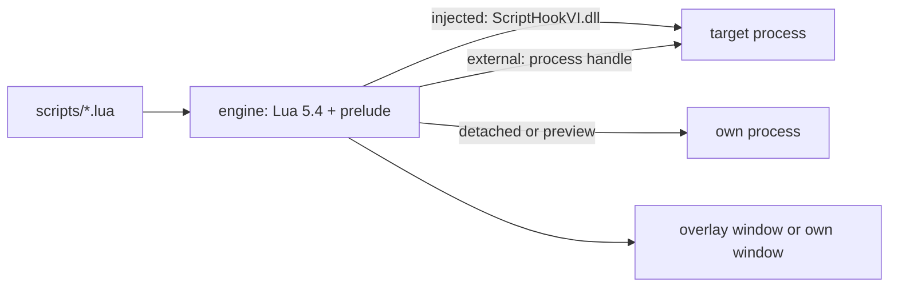

ScriptHookVI runs Lua scripts inside a running Windows process. Scripts read and write the process's memory, call functions in it, draw over its window and build menus. In these docs "the title image" means the image the engine looks for in the target process: the largest loaded module of at least 64 MB other than the main executable or, when there is none, the largest image of at least that size found by walking the process's memory.

ScriptHookVI does not start the target process. ScriptHookVI-inject waits up to 60 seconds for it (set by its third argument), ScriptHookVI-external keeps looking for it while it runs, and `--run` waits `--wait` seconds (default 0). The repository includes a preview mode that needs no other process.

## The pieces

| Piece | Source | What it does |
| --- | --- | --- |
| `ScriptHookVI.dll` | `src/` | The engine. Injected into a process, it runs the scripts there and draws through its own transparent window over the process's window. |
| `ScriptHookVI-inject.exe` | `src/bin/inject.rs` | Copies the DLL to a `run/` folder next to it and loads that copy into a running process, named by its executable name or its pid. Injecting again replaces the running engine. |
| `ScriptHookVI-external.exe` | `src/bin/external.rs` | The same engine in its own process. It reads, writes and scans the target process's memory through a process handle but cannot call functions in it. It runs in its own window, and draws over the target's window instead only while it is attached and `--overlay` was given. With `--run` it runs one file against the process and exits. |
| `src/prelude.lua` | `src/prelude.lua` | The Lua library loaded before any script: `on_frame`, `script` and `wait`, the memory helpers, signatures, `game.at` and `game.on_thread`, and the menu library. |
| Scripts | `scripts/` next to the engine | Every `.lua` file in the scripts folder in name order, then every `.lua` file directly inside each subfolder, the subfolders in name order with `user/` last, reloaded when a file changes. |
| Preview | `examples/preview.rs`, `preview.sh` | Loads a scripts folder with no process attached and draws what the scripts draw: `examples/preview.rs` writes the pixels as raw RGBA, and `preview.sh` builds and runs it and turns the result into a PNG. |

On its own timer an engine ticks the scripts about 60 times a second (`engine.tick_ms`, default 16). In the injected engine, once the title image is found and `game.at("frame_update")` gives an address for its build, the prelude moves the tick onto the target process's own thread with a detour at that address, unless the setting `engine.game_thread` is `false`. The engine then ticks at most once each time that function runs, and falls back to its timer while the function has not run for 250 milliseconds. The external engine always ticks on its timer. A tick runs the per-frame callbacks and the script threads, then the menu, then draws what the scripts asked for. See [Scripts](/scripts) for the details.

## The example script

The repository ships one script, `examples/scripts/example.lua`. It builds a small menu and, while the menu's "Show the clock" toggle is on, draws the time in the top right corner. `scripthookvi.builds` and `scripthookvi.offsets` start empty and no file in the repository fills them, so without a script of your own that fills them `game.build()` returns `"unknown"` once the title image is found, and `game.at` returns `nil`.

There is no menu until a script creates one with `menu.new`: the first menu created becomes `menu.root`, and F4 (`menu.key`) opens it. See [Menus](/menus) for the menu library. The engine writes its messages to `ScriptHookVI.log` next to the engine, except in the preview and with `--run`; see [Install and run](/getting-started).

## Known limits

- While the external engine is attached to a process, `game.call` and functions made with `game.fn` raise `calls need the injected engine; this one is external`. With no process attached, the external engine and the preview call into their own process.
- `game.call` passes integers, booleans and `nil` only; `game.fn` takes floats. A fault inside a call returns `nil, "fault ..."` and the process keeps running, but memory the callee wrote stays written.
- In the injected engine, `menu.block` hides keys only from `GetAsyncKeyState` and `GetKeyState` as the process's main executable imports them from `user32.dll`. Keys read any other way, and pad buttons, still reach the process. The external engine hides no keys.

## Legal

See `LEGAL.md`, `SECURITY.md` and `CONTRIBUTING.md` in the repository. The code is under the MIT licence. The bundled fonts (Inter and JetBrains Mono) carry their own licences, in `assets/LICENSE.txt`, and third-party components are listed in `THIRD-PARTY-NOTICES.md`.

## Where to go next

<CardGroup cols={2}>
  <Card title="Install and run" icon="download" href="/getting-started">
    Build the engine, pick a mode, and run a first script.
  </Card>
  <Card title="Scripts" icon="code" href="/scripts">
    Load order and subfolders, hot reload, per-frame callbacks, threads and settings.
  </Card>
  <Card title="Menus" icon="bars" href="/menus">
    The menu library, and how to build a menu with it.
  </Card>
  <Card title="Lua API" icon="book" href="/lua-api">
    Every function the engine and the prelude provide.
  </Card>
</CardGroup>
